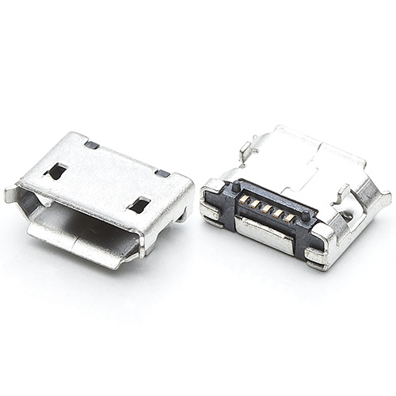
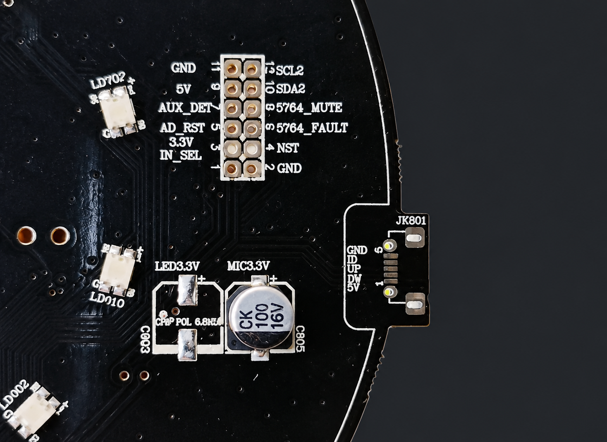

# 12｜主板 USB 接口與備份先行

這份說明記錄本專案 HD 主板的實際接入經驗，供訪客判斷準備工作。它不是所有 HD 板次通用的焊接圖，也不是刷機步驟。執行任何韌體或主板操作前，先完成並核對該台設備的備份。

## 本專案使用的接入方式

這台 HD 曾透過主板預留的 USB 焊盤，固定標準 Micro-USB 接口，再連接電腦進行 USB WorldCup 備份與刷寫作業。這是本專案所用設備的經驗，不代表每台 HD 的板次、焊盤位置或工具流程都相同。

圖 1 只示意接頭外形；圖片來源與再散布授權未核實。它不表示主板焊盤位置或接線順序。

參考照片中，板邊的 JK801 附近可見 `GND`、`ID`、`UP`、`DN`、`5V` 標示。它們看起來與 Micro-USB 五線接口相符；照片本身不能確認 `UP`／`DN` 的電氣定義、焊盤順序或不同板次的一致性。旁邊的 2×6 調適排針有另一組訊號標籤，不能因為相鄰就當成 USB 焊盤。

接線前應確認設備型號與 PCB 版本，並依該板次可靠的原理圖或量測結果確認每個焊盤。不要只照照片位置接線，不要把 5V、資料線或相鄰訊號短接，也不要在主板通電時焊接或移動接頭。圖片中的 Micro-USB 外觀只說明接頭形式，不能作為腳位圖。

圖 2 是根據使用者提供的主板截圖製作的隱私裁切，已移除條碼／貼紙、平台浮水印與手機介面。這張生成式裁切可能改變細小的絲印文字，只供辨認 JK801 與附近排針的大致位置；請以實物、板次原理圖和量測為準，不要從圖上讀取腳位或照圖焊接。

## 操作前的備份門檻

任何會修改韌體、寫入分區或改變設備狀態的操作前，都先完成該台設備自己的備份，並把備份複製到音箱以外的安全位置。若尚無備份，只進行取得備份所需的唯讀讀取；不要先刷寫或修改。至少應記錄：

- 實機型號、硬體版本、韌體版本與當前啟動槽。
- 實際分區表、啟動環境，以及可讀取的 boot、system、data 分區內容或原始映像。
- 每個輸出檔的預期大小、實際大小與 SHA-256；無法讀取或雜湊不一致的項目須標為不完整。
- 備份來源、時間、所用唯讀命令／工具版本，以及原始檔的第二份離線副本。

能讀出檔案、傳輸雜湊一致或保留另一個 system 槽，都不等於已證明可完整刷回。先確認目標分區、映像格式與幾何資料，並有可信的復原方式；缺少其中任一項就先停在唯讀盤點。

本專案這台設備的 Bootloader 備份仍未完整涵蓋 2 MiB，備援槽啟動與整機刷回也沒有驗證。因此目前資料不能支持完整救援能力的宣稱；對這台設備而言，這是停止刷寫的理由。私人備份留在本機，不要上傳到 GitHub。

## 主板操作檢查表

1. 確認機型及主板版本；先讀取此文件和[HD／Pro 差異指南](06-hd-vs-pro-modding.md)。
2. 斷開電源，採取防靜電措施；確認接入點、焊盤與轉接線方向，不用手持裸線冒險維持接觸。
3. 先做唯讀備份，檢查分區資料、檔案大小和雜湊，並保留離線副本。
4. 核對備份可用範圍、寫入目標與復原方式。任何一項不明確，就不進行寫入。
5. 刷寫後保存操作紀錄及讀回結果；不要把「命令成功」當成啟動或復原驗證。

USB WorldCup 連線只代表主機看見了 USB 裝置，不代表已正確識別分區、已備份完整 Bootloader，或已具備刷回能力。使用的工具與命令必須符合該台 HD 的韌體、板次及分區表；不要沿用 LX06／OH2P 的映像或刷寫參數。

## 圖片與識別資料

原始主板截圖含有條碼／貼紙區與影片平台浮水印，沒有直接放入文件；倉庫只收錄圖 2 的生成式隱私裁切。若日後要公開實物原圖，先遮住條碼、序號及其他識別資料，並確認圖片來源可以再發布；同時附上板次和腳位核對依據，避免讀者把示意照片當作通用接線圖。
